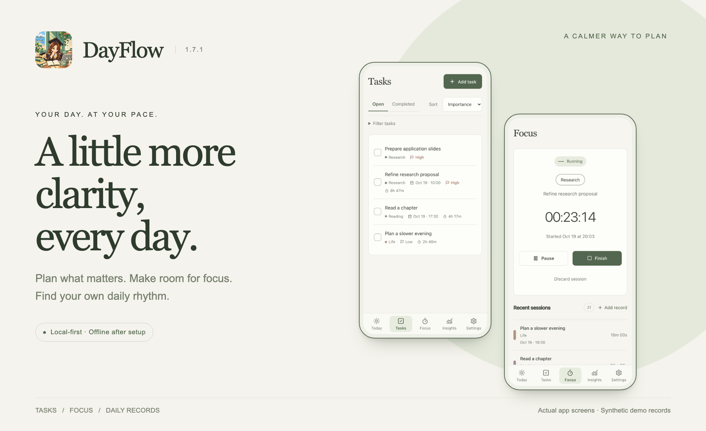
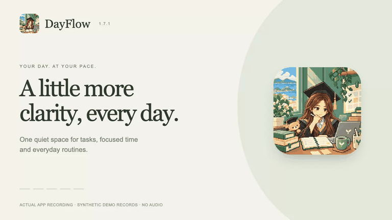
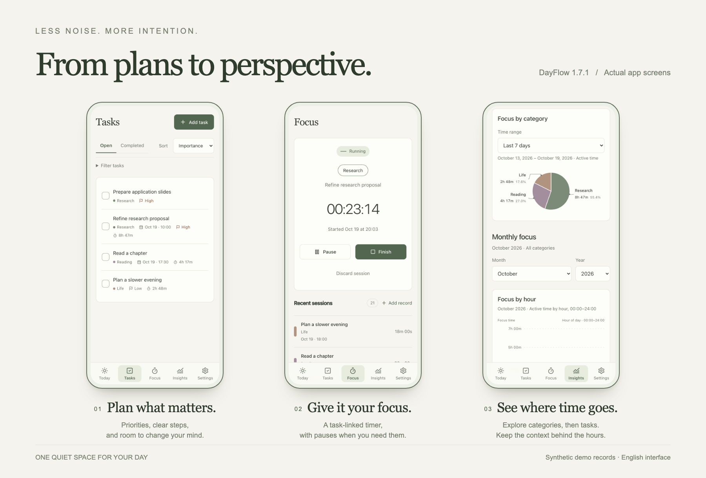
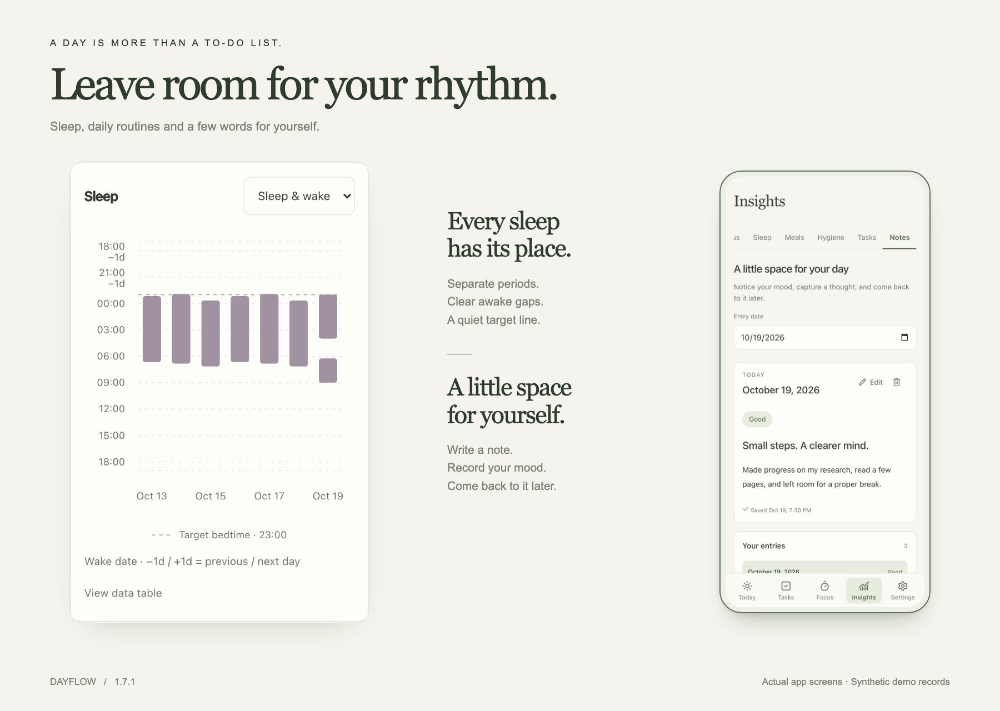

  

<h1 align="center">A little more clarity, every day.</h1>

A calm, local-first space for your tasks, focused time and everyday rhythms.

  <a href="https://jiangyt1412.github.io/dayflow/"><strong>Open DayFlow ↗</strong></a>
  &nbsp; · &nbsp;
  <a href="#see-dayflow-in-motion">Watch the demo</a>
  &nbsp; · &nbsp;
  <a href="README.zh-CN.md">简体中文</a>

No account required · Offline after setup · No automatic cloud sync

<strong>Version 1.7.1</strong> · <a href="CHANGELOG.md">What’s new</a> · <a href="QA.md">Validation</a>

## See DayFlow in motion

Complete a task, run a Focus session, explore a category’s tasks, review split sleep and save a note. This is the current application being operated with synthetic records.

<a href="https://github.com/Jiangyt1412/dayflow/blob/main/docs/media/dayflow-demo-v171.mp4"><strong>Full demo · MP4 ↗</strong></a> Actual app recording · Synthetic demo records · No audio

## From plans to perspective

| Plan what matters | Give it your focus | See where time goes |
| --- | --- | --- |
| Separate **Open** and **Completed** tasks. Set priorities, subtasks and optional dates. Keep unsaved edits safe. | Link a task, start, pause, resume and finish. Add missed sessions or correct saved records. | Explore categories and task pies, time-of-day patterns and longer trends over your chosen range. |

## Leave room for your rhythm

Every completed sleep period has its own interval, including multiple sleeps on one wake date. Awake gaps stay visible, overlapping time is counted once in daily totals, and your target bedtime is a quiet gray reference.

Record meals and personal care too. In **Insights → Notes**, write a few words, record your mood and return to earlier entries.

## Make yourself at home

1. **[Open DayFlow](https://jiangyt1412.github.io/dayflow/).** Create a category in **Settings**, then add your first task.
2. **Try a Focus session.** Choose a category, optionally link a task, and start. Saved sessions keep the task name even after its task is deleted.
3. **Add it to your iPhone Home Screen.** In Safari, choose **Share → Add to Home Screen**. Open it online and wait for **Settings → Ready to work offline**.

The interface is in English. **Settings → Check for updates** checks for a newer app; follow the update prompt when one is available.

## Your records stay on your device

Records are stored locally in the browser or installed app you use. **There is no account or automatic cloud sync.** Different devices, browsers or Home Screen installations may hold separate records.

- **Export backup:** a complete JSON backup, including saved Notes. Keep a copy periodically and before moving to another installation.
- **Import backup:** validates that JSON and, after confirmation, **replaces** current local records. It does not merge two sets of data.
- **Export CSV:** selected records for spreadsheets; it is not a full backup.

Backups are readable, unencrypted files. Clearing website data can remove local records.

<strong>About this repository and media</strong>

This repository hosts the published static web build and product documentation on GitHub Pages. The editable source project is maintained separately. The application uses **React, TypeScript, Vite, Dexie / IndexedDB and Recharts**.

The images above combine current application screenshots with a designed layout. The video records actual interactions; all illustrated records are synthetic. The pixel-art icon was supplied by the project owner. See [media notes](docs/media/README.md) for provenance and formats.

Release history belongs in the [changelog](CHANGELOG.md). The latest validation and physical-device limits are documented in [QA.md](QA.md).

<strong>Find your daily rhythm.</strong> <a href="https://jiangyt1412.github.io/dayflow/">Start with today ↗</a>

